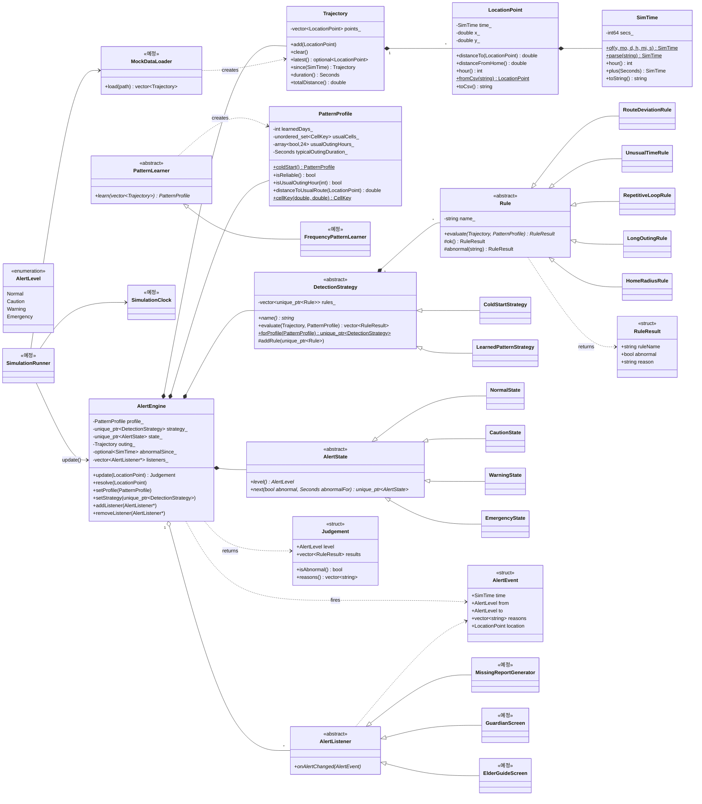

# 클래스 다이어그램 초안 (11/24, 민규) — C++17

> 노션에 붙일 때: `/code` 블록 만들고 언어를 **Mermaid**로 바꾼 뒤 아래 코드 붙여넣기 → 그림으로 보임.
> `<<예정>>` = 아직 코드 없는 클래스 (각 담당자가 만들 것). `<<abstract>>` = 순수 가상 함수(`= 0`) 있는 클래스.

## 소유 관계 (C++ 메모리)

| 누가 | 무엇을 | 방법 |
|---|---|---|
| AlertEngine | 현재 Strategy, 현재 State | `unique_ptr` (교체하면 이전 것 자동 해제) |
| DetectionStrategy | 규칙들 | `vector<unique_ptr<Rule>>` |
| AlertEngine | 리스너 | `AlertListener*` **소유 X** → 화면이 먼저 사라지면 `removeListener` 먼저 |
| 그 외 (LocationPoint, Trajectory, PatternProfile, 결과 struct) | | 값으로 복사 / `const&`로 전달 |

## 패키지(폴더) / 담당

| 폴더 | 클래스 | 담당 |
|---|---|---|
| `src/model` | SimTime, LocationPoint, Trajectory, AlertLevel | 민규 (완성) |
| `src/config` | Thresholds.h | 민규 초안 → 코드B 수치 확정 |
| `src/pattern` | PatternProfile, PatternLearner | 인터페이스 민규, 학습기 구현 코드B |
| `src/rule` | Rule + 규칙 5개 | 뼈대 민규, `TODO(코드B)` 채우기 |
| `src/strategy` | DetectionStrategy, ColdStart / LearnedPattern | 민규 (완성, 규칙 구성은 코드B 조정) |
| `src/alert` | AlertState 4개, AlertEngine, AlertListener, AlertEvent, Judgement | 동작하는 초안 민규 → 코드B 검토·수정 |
| `src/sim` | SimulationClock, MockDataLoader, SimulationRunner, MissingReportGenerator | 코드A |
| `src/ui` | GuardianScreen, ElderGuideScreen, 지도 패널 | 지후 (지도 패널 코드A) |

## 패턴 대응 (보고서·발표용)

| 패턴 | 어디 | 왜 |
|---|---|---|
| 상속·다형성 | `Rule` ← 규칙 5개 (`virtual evaluate`) | 새 규칙 추가해도 엔진 코드 안 바뀜 |
| Strategy | `DetectionStrategy` ← ColdStart / LearnedPattern | 학습 데이터 7일 미만이면 고정 기준, 이후 학습 기준으로 자동 전환 |
| State | `AlertState` ← 4단계 | 단계별 전이 규칙을 각 클래스가 가짐, if문 덩어리 제거 |
| Observer | `AlertEngine` → `AlertListener` | 엔진은 화면을 모름. 화면·신고 생성기가 구독만 하면 됨 |

## 경보 단계 전이 (초안)

| 현재 | 조건 | 다음 | 대응 |
|---|---|---|---|
| Normal | 이상 규칙 1개 이상 | Caution | 본인에게 큰 글씨·음성 귀가 안내 |
| Caution | 정상 복귀 | Normal | |
| Caution | 최초 이상부터 10분 지속 | Warning | 보호자 알림 |
| Warning | 정상 복귀 | Normal | |
| Warning | 최초 이상부터 30분 지속 | Emergency | 실종 신고 정보 생성 |
| Emergency | 보호자 해제(`resolve`)만 | Normal | 집에 와도 자동 해제 X |

## 오늘 합의 필요한 것

1. **좌표계** (코드A): 초안은 평면 좌표, 미터, 원점 = 집. 위경도로 가면 `LocationPoint::distanceTo`만 하버사인으로 교체.
2. **CSV 포맷** (코드A): 초안 `2026-11-24T08:30:00,120.5,340.0` (시각, x, y). 헤더 줄 넣을지.
3. **수치** (코드B): 300m/10분, 심야 22~05시, 콜드 스타트 7일·1km, 단계 상승 10분/30분, 격자 50m.
4. **Emergency 해제**: 보호자 수동 해제만 할지, 귀가하면 자동 해제할지.
5. **외출 종료 판정**: 집 반경 50m 안에 들어오면 이번 외출 기록 초기화 — 괜찮은지.
6. **화면 라이브러리** (지후): Qt / SFML / Dear ImGui 중 뭐 쓸지 → 정해지면 CMakeLists.txt에 추가.
